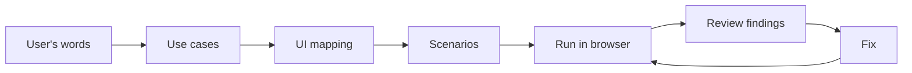

# UX walkthrough: needs → use cases → UI → simulated walkthrough → fixes

A **development and debugging tool**. Use it while building or changing a UI, or before handing a visual
result to the user, to confirm it serves their real needs. It is not part of the product the user runs.

The aim is to see the product the way the user will, not to tick off features. Use this loop:



## 1. Write use cases from the user's context

1. Collect everything the user said about their needs: their messages, feedback on earlier versions,
   docs such as `doc/goal.md`, and `doc/use-cases.md` if it exists. Quote their words. Phrase each need the
   way they would say it ("Did the agent understand me?"), not as a feature ("requirements panel").
2. Write or update `doc/use-cases.md` from [use-case-template.md](references/use-case-template.md):
   - personas;
   - the principles the user asked for (one line each);
   - one row per use case: ID, need, actor, the UI that serves it, and what "good" means. Make
     "good" measurable: clicks, what must be visible without clicking, how fast something appears.
3. Every past complaint from the user becomes a principle and at least one check. Examples: "too much
   on a card" becomes a density limit; "I get lost" becomes "a way back is visible at every level".

## 2. Encode each use case as a scenario

Put scenarios in the project (e.g. `tests/ux/scenarios.mjs`), not in this skill. The format, with
all step types, is in [scenario-format.md](references/scenario-format.md). For each scenario:

- start from the user's entry point (`goto`), then only do what the user would do;
- `expect` the things the use case says must be visible;
- use `cli` / `cliFails` steps for other actors (an AI agent, a backend job), so the scenario is the
  whole story: the agent acts, the user sees it, the user answers, the agent sees the answer;
- `shot` at each moment the user would judge the screen;
- `density` on each level that the user reads at a glance;
- set `maxClicks` from the "good" column.

Run against isolated state (separate port and data directory in `setup`), never the user's own data.
Scenarios run in order and share that state. If one depends on another, for example on a project that
another scenario creates, include both when using `--only`.

## 3. Run

```sh
node .agents/skills/ux-walkthrough/scripts/walkthrough.mjs tests/ux/scenarios.mjs [--only UC-3] [--headed]
```

This needs `playwright-core` in the project (`npm i -D playwright-core`) and a local Chrome. The script is
[walkthrough.mjs](scripts/walkthrough.mjs). It writes `ux-report/report.md` with a summary table, the
steps of each scenario, density figures, console errors and screenshots.

## 4. Review: passing is not enough

Open the report and **look at every screenshot** as the user would. Use
[heuristics.md](references/heuristics.md). For each finding, record:

- the use case;
- what the user would feel ("I can't tell which phase I'm in");
- severity: blocker / friction / polish;
- the fix.

Also review the CLI outputs as the agent would. An unclear message for the agent is a finding too.

Write findings to the walkthrough artifact (or `ux-report/findings.md`). Classify honestly: a
scenario that passes with friction still has a finding.

## 5. Fix and re-run

Fix blockers and friction. Tighten the scenarios so the fixed behaviour stays checked, for example by
adding an `expect` or lowering `maxClicks`. Re-run until everything passes and the screenshots hold up
in review. Then show the user the before/after screenshots and the findings table, and **ask for their
confirmation**. Don't assume it is done.
