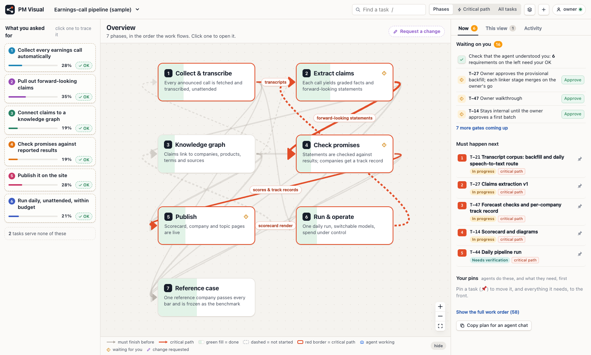
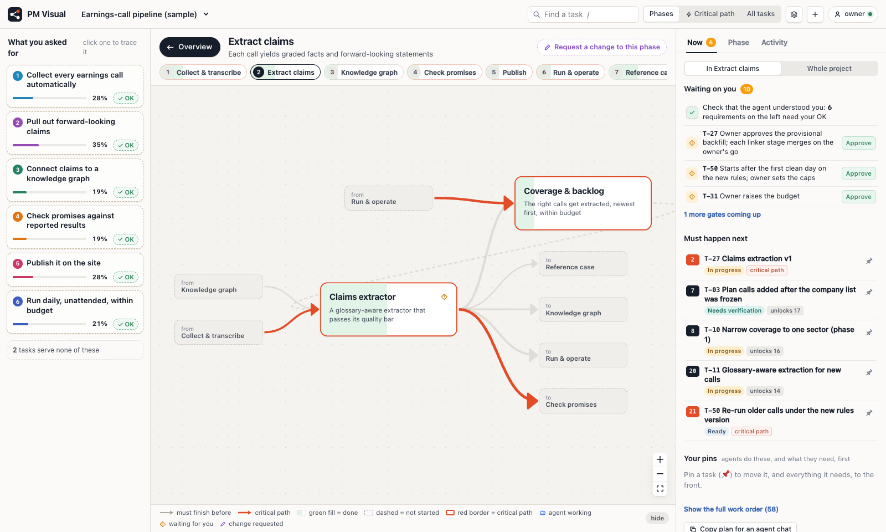
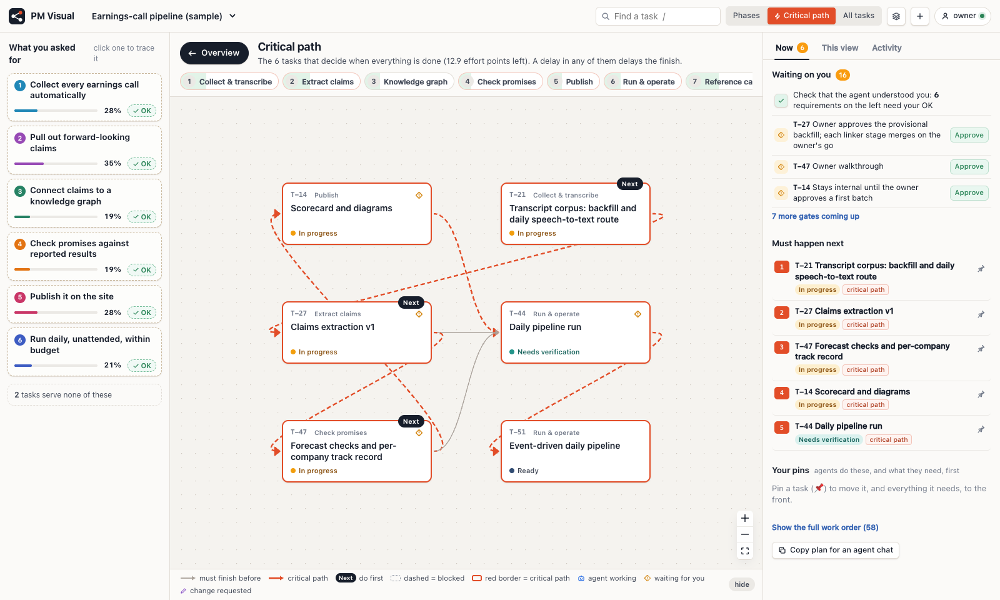
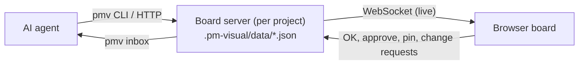

# PM Visual

**A lightweight visual task board that an AI agent keeps from the command line, and you read and
steer in the browser.**

When you hand an AI agent a job, two questions usually stay open: *did it understand what I asked
for*, and *is it doing things in the best order*. PM Visual turns the agent's plan into a live flow
chart you read **top-down**:

1. **What you asked for**: your requirements, rephrased by the agent. Click OK on each one.
2. **Phases**: the 3–7 big pieces, with a goal each, chosen by the agent for this job.
3. **Tasks**: inside each phase, with what they wait on.
4. **Now**: what must happen next, what's waiting on you, and what the agent is doing.

From the board you can answer the agent, approve gates, pin "do this first", and click **any**
element to request a change. The agent picks it all up through its CLI.



| Inside a phase | Critical path |
|---|---|
|  |  |

## Quick start

In any project:

```sh
npm i -g https://github.com/timhuang1018/pm-visual-tool/releases/download/v1.2.0/pm-visual-1.2.0.tgz
                                                     # the `pmv` CLI (runtime dependency: ws); no package.json changes
pmv init                                             # creates .pm-visual/, starts the board, installs the agent skill
pmv open --browser                                   # opens http://127.0.0.1:<port>/#/<project>
```

Then ask your agent something like *"plan this on the board"* or *"show me the tasks visually"*.
`pmv init` installs the [`pm-visual` skill](agent/pm-visual/SKILL.md) into `.claude/skills/` and
`.agents/skills/`, unless you already have it user-wide. The skill teaches the agent to:

```sh
pmv import plan.json    # requirements, phases, tasks, links, notes, all in one file
pmv check               # fix what makes the chart hard to read
pmv brief               # every session: ~12 lines, your requests first, then critical path and next
pmv start T-04 && pmv done T-04
pmv ask T-02 "Week or month?"
pmv shot                # screenshot a view to check it before handing over (optional, needs playwright-core)
```

Try it without an agent: `pmv demo`.

### With a backlog

If the repo keeps a backlog (`docs/BACKLOG.md`, owned by a PM agent), the board becomes a sketch
layer in front of it. It shows how a chosen slice of rows relates, and stages new work as proposals:

```sh
pmv pull BL-101 --related          # lists BL-101 and the rows it names; nothing added yet
pmv pull BL-101 BL-102 --yes       # mirrors them: status and size stay owned by the backlog
pmv proposals                      # board-only work as ingest cards for the PM
pmv adopt T-03 BL-120              # once the PM wrote the row, the card becomes it
pmv subtasks add BL-101            # show the steps in BL-101's brief ("## Subtasks" table)
```

The board keeps itself current: every page load (and every file change) re-reads the backlog and the tracked
briefs, so agents only update the PM's documents. Format and commands: [docs/cli.md](docs/cli.md#brief-subtasks).

## What you see

| Where | What it shows | Why |
|---|---|---|
| **Left: What you asked for** | Requirements. A dashed card is the agent's reading and waits for your **OK**. Click one to trace everything that serves it. | You check that you were understood before work starts |
| **Overview** | Phase cards in reading order. Green fill = done, red border = on the critical path, dashed = not started. Link labels say what flows between phases. | The big picture at a glance |
| **Inside a phase** | Its sub-groups or tasks, plus stubs for the phases it connects to. **← Back**, the breadcrumb and the phase strip keep you oriented. | Detail one level at a time |
| **Critical path** | Only the chain of tasks that decides when everything is done, each card labelled with its phase. | Where a delay costs the most |
| **All tasks** | Every task, boxed by phase. | The full map when you need it |
| **Right: Now** | What's waiting on you, what must happen next (it changes as work moves), your change requests and pins. | What to do right now |
| **Right: Details** | Everything about the selected element, plus a conversation: **change request**, instruction, question or note. | Steer by pointing |

Keys: `/` find a task, `c` critical path, `Esc` deselect, then up one level.

## How it fits together



The board server is a single small Node process per project. It starts automatically when the
agent runs a command. Data lives in `.pm-visual/data/` inside your project, so you can commit it or
ignore it as you like.

**The board adapts to the job.** Phases are whatever the agent chooses (*Ingest → Model → Dashboard*,
*Research → Draft → Review*, …). Any task, phase or requirement can carry free-form `meta`
(`{"repo": "https://…", "owner": "Ana"}`), which is shown in Details.

## Documentation

| Doc | For |
|---|---|
| [agent/pm-visual/SKILL.md](agent/pm-visual/SKILL.md) | **Agents**: how to plan, scope, work and hand proposals to the backlog (installed per project by `pmv init`, or `skill-sync install pm-visual --scope project`) |
| [docs/cli.md](docs/cli.md) | Every `pmv` command, environment variables, files |
| [docs/data-model.md](docs/data-model.md) | `plan.json` schema, element references, how the critical path and work order are computed, plan checks, HTTP API |
| [docs/development.md](docs/development.md) | Working on PM Visual itself: dev server, tests, packaging, the UX walkthrough tool |
| [doc/use-cases.md](doc/use-cases.md) | The owner and agent use cases the UI is designed and tested against |
| [CHANGELOG.md](CHANGELOG.md) | Versions |

## Development

```sh
npm install
npm run dev     # API on :4317 (with the sample project) + UI on http://localhost:5173
npm test        # unit tests
npm run ux      # walk through every use case in a real browser, with a screenshot report
npm run build   # type-check, UI bundle (dist/ui), CLI bundle (dist/cli.js)
```

See [docs/development.md](docs/development.md).
