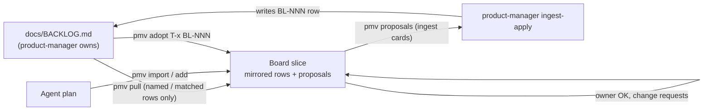

# Backlog bridge

Use the board as a sketch layer **in front of** a repo's PM backlog (`docs/BACKLOG.md`, owned by the
`product-manager` role): show how a slice of existing rows relate, stage new work as proposals,
and hand the confirmed proposals to the PM for ingest. The board stays high level and never
writes the backlog.

| Component | Role |
|---|---|
| `shared/backlog.ts` | Parse backlog Markdown tables (any column order, escaped pipes); short card titles; row mentions |
| `Store.syncBacklog` / `Store.adoptTask` | Mirror rows; turn an ingested proposal into its row (renames every reference) |
| Mirror rule (store) | Status and sizing of a mirrored task come only from the backlog |
| `shared/briefText.ts` | `pmv brief` (session digest) and `pmv proposals` (ingest cards) |
| Plan checks | `BOARD_LARGE`, `DONE_WAITS_ON_OPEN`, `BACKLOG_MENTION` |
| `agent/pm-visual/` | Agent skill, published to skill-repo as `pm-visual` (experimental, project scope only) |

## Status

Completed (1.1.0):
- mirrored rows, proposals, adopt, pull with dry run;
- brief and proposals texts, the new plan checks;
- board encoding for proposals and backlog rows;
- skill restructure, product-manager handoff.

Future:
- an owner "send to backlog" action on the board, if chat-based ingest proves too indirect;
- reading dependencies from structured backlog fields, if a backlog ever gets one.
